# Nigiwai

Read a room's crowd. Venues put a QR poster on the counter; guests say what they love in about a minute, with no account and no personal details; the owner sees who their crowd is. Taste data comes from [Qloo](https://qloo.com), always through one guarded path.

Status: work in progress. [docs/BUILD_STATE.md](docs/BUILD_STATE.md) says exactly what is built, what is tested and how, and what is open.

## What works today

- **Try it without an account** (`/` and `/try`): three real venues (Mercury Lounge in New York, The Hideout and Empty Bottle in Chicago), each read from the public lineups of its past events and matched to Qloo. Anyone can open one, check any act against it, see the crowd map and download the Booking Brief. Scores there are provisional and say so; checking a new act calls Qloo, so each network and the whole site have daily limits. Any other music venue on MusicBrainz can be searched for on `/try` and asked for: it is built in the background from its public lineups (a few minutes, over a hundred Qloo calls, a handful of new venues a day for the whole site), opens by itself when ready, is kept for seven days and then deleted.
- **Guest survey** (`/s/<token>`): consent notice, a type-ahead picker backed by a local index and live Qloo search, optional age band, area (tapped from a list the owner gives, or a short typed place name) and budget, a receipt code, and removal of your own answers. A guest can also name favourite places: searched near the room, offered by name and address, and never a place that stands for a religion, a health service, an orientation, a political body or adult entertainment.
- **Owner app** (`/app`): sign up, describe the venue, configure and publish a survey, create QR codes, download an A4 poster or A6 table card.
- **Taste Card**: after sending, a guest gets a card from their own picks at once, and a few related tastes and places near the venue a moment later (at most three Qloo calls). Shareable as an image.
- **My people** (`/app/people`): once 60 guests have answered, soft groups ("tribes") with their tags, most-picked items, weekday and hour rhythm, unusual pairings and a coarse age and gender lean from Qloo's audience data. Names unlock at 200 guests. A group is shown only if the crowd is more stable than two shuffled versions of itself; every figure carries a measured, observed or modelled label, and "How this was computed" is on the page.
- **Public-lineup start**: a venue with no guests yet can pick itself in MusicBrainz (public domain) and see who has played there, matched to Qloo by exact id or name.
- **Proof** (`/app/proof`): every Qloo call made for the owner, what was sent and what came back, usage by purpose, and a check that nothing shown is missing from what Qloo returned.
- **Soundcheck** (`/app/soundcheck`): pick any act and see how well it fits your crowd, 0 to 100, with the likely range, how it ranks for each group, why, what to watch, the nights it suits, and the working. The score is computed in code from what Qloo says about each group (one call per group); the formula, the weights and every Qloo call behind it are on the page. It works from your own guests, or provisionally from public lineups. Suggested acts and a Wildcard are built for your crowd.
- **Qloo against an AI alone**: beside every Soundcheck, the same question put to Qloo and to a language model with no tools. It marks which acts are real Qloo entities, counts agreement without ranking either side, and says so when a model does not know an act (needs a model key; without one it says there is no AI answer).
- **Booking Brief** (`/app/brief`): one page for a booker or partner: your crowd, three acts with scores and per-group fit, a Wildcard, the best nights. Save it as a one-page PDF or make a share link that expires in 30 days and can be turned off. Names and our own scores only.
- **Crowd map** (`/app/map`): your sites on a real map with how many guests scanned and who they are, hexagons for the neighbourhoods guests say they come from, and what Qloo says is around. A site or neighbourhood with fewer than 10 guests is only a pin or a count. Choose the period, turn layers on and off, and copy a link that reopens the view. A Gaps layer marks a group Grow found no place for as a dashed candidate, and a Moves layer flags the changes you logged on the timeline; neither claims a cause.
- **Today** (`/app/today`): this week's quietest hours from your scans and opening hours, and up to three actions (fill an empty chair, book an act, reach people you are missing), each with its reason, evidence labelled measured, observed or modelled, and the Soundcheck behind it. Accept, dismiss, or log an accepted action as a move. With too little data it says what would unlock more instead of guessing, and opening it makes no Qloo call.
- **Ask Nigiwai** (`/app/ask`): ask about your crowd or about taste and culture. A model with a fixed set of Qloo-backed tools answers, and code checks the answer before you see it: every item must have been returned by a Qloo call during the question, names come from Qloo's records, a name in the sentences that no call returned is removed, and an evidence label has to be earned. The steps stream as they happen, the answer is stored, and the Qloo calls behind it can be reopened. It needs an AI service (`NIGIWAI_ANTHROPIC_KEY_FILE` or `ANTHROPIC_API_KEY`); without one it says so before you type.
- **Your plan** (`/app/onboarding`): an interview of at most eight questions about the business (kind, address, goals, currency, then opening hours, live music, show nights, excluded genres, room size). With an AI service it can also read a few sentences about the business, recording only what the owner actually wrote; without one, or when it fails, it is a fixed form. The owner checks what was understood, changes any answer, picks the address from OpenStreetMap's search if they want a map position, and confirms. Only then is anything saved. The tools switched on for the business come from fixed rules, each with its reason, and the owner can switch any of them.
- **Sound plan** (`/app/sound`): which acts to play at which time of the week. Each stretch (a part of the day, on weekdays or the weekend) takes its crowd from when each group scanned, ranks the acts already scored for your groups with the Soundcheck formula, and says how busy it is. Stretches with too few scans, or when you are closed, name nothing. Artists, not songs: your own licensed service supplies the tracks. Opening it makes no Qloo call.
- **Grow** (`/app/grow`): who else might come, who already serves your crowd nearby, and places like yours further out. A button press queues a worker that asks Qloo (about a dozen to twenty-five calls) for the acts next to each group's favourites and for open places of your kind around you; the page then reads the stored result and never calls Qloo itself. A "ghost" is a genre those neighbouring acts share, beside a genre the group clearly has, that almost none of your guests carry. Three checks, printed on the page, decide what it may claim: Qloo's neighbouring acts must differ between your groups; a list of places is only called "matched to your crowd" if Qloo changed it when given your crowd's taste; and places are only listed per group, or a group called a gap candidate, if Qloo gave your groups different places. On the three real venues we probed the last check fails, so the page says places are for the crowd as a whole. Closed places are left out; open ones are Qloo's word and are labelled so.
- **City Taste Atlas** (`/app/atlas`): an opt-in, anonymous roll-up of what guests pick in a neighbourhood square (about a kilometre), pooled across venues that chose to join. A venue joins with an explicit step and can leave at any time; a venue that has not joined sees nothing and shares nothing. The pooling is a database function that only writes rows meeting the minimums (a venue counts with 10 answers, a neighbourhood opens with 5 such venues, an item is listed with 10 answers from at least 3 venues and no more than half from one), and the table has no column that could name a venue. It cannot show real data until neighbours join; until then it says so and offers an example marked as invented.
- **Team** (`/app/team`): who is in the account and what each may do. An owner makes an invitation link for a manager or a viewer and sends it themselves (nothing is emailed from here); it works once, expires after a week and can be withdrawn. The secret sits after the `#` in the link, which a browser never sends, and only its hash is stored. A new person signs up from the link or, if they already have an account, joins with it and switches between accounts. Owners change roles and remove people; the database refuses to leave an account without an owner.
- **Your login** (`/app/account`): change the password (every other device is signed out), make a new recovery code, sign out everywhere, start another venue, and delete an account and everything in it, or the login itself. There is no emailed reset because no email service is configured: signing up shows a recovery code once (kept only as a hash) and `/forgot` uses it to set a new password; each code works once and a fresh one is shown. You can download a copy of your account's data (a ZIP of JSON files and a CSV, with a README that says what is left out: no password, hash, session or secret, and no single guest's answer). Deleting an account removes every row that belongs to it, including its Qloo call log and, at once, its counts in the Atlas; a login cannot be deleted while the person is the only owner of an account.
- **Moves** (`/app/moves`): log what you changed (an act booked, a menu item, a price) with the days and hours it was aimed at, or log it from an accepted Today action. Nigiwai counts scans in that slot in the four weeks before and the days since, shows the rate before and after with a 90% range, and says "inconclusive" or "too early" whenever the sample cannot support more. It never says a change caused a result.
- **Drafts** (`/app/drafts`): from an action you accepted on Today, an enquiry to the act, an event page and a post; for any group, an ad angle with a headline and text inside the usual limits. They are filled from your own records only; every fact it cannot know is a [bracketed] gap you must fill before the draft can be approved. Approval is of the saved words, and editing takes it back. Nothing is sent: an approved enquiry can be opened in your own email program, and every step is in the audit log.
- **Qloo Guard** (`packages/qloo-guard`): every Qloo call goes through typed requests, rule checks, a private cache, a rate limiter, a monthly budget and a trace.
- **Privacy by construction**: no IP address, user agent or exact time is stored with an answer; every tenant table is protected by row-level security that the application role cannot bypass.

## Sample Booking Briefs

The deliverable is the one-page brief an owner forwards to a booker. Open `/try`, choose a demo venue, check an act and download its Booking Brief, or run `just samples` to save one PDF and PNG per demo venue to `docs/samples` (not committed: each holds item names and up to three genre labels for each act, and whether Qloo allows showing its output in that form publicly is not confirmed, docs/HUMAN.md H8). Each brief is **modelled from public lineups** (MusicBrainz), not from guests, holds item names, genre labels and our own scores, and says how every number was computed.

## Screenshots

A made-up room, made-up guests and made-up acts: no Qloo data and no real person's details are in these pictures (the sample briefs above are the one place the repository shows Qloo-derived names). Where a line on a screen speaks of Qloo, for example that a suggested act is "a real act in Qloo's graph", it describes what the product does with a real suggestion and is illustrative here, because these acts are invented. They are made by `NIGIWAI_SHOWCASE=1 npx playwright test e2e/showcase.spec.ts` (see Browser tests), from guests planted through the same database function the survey uses; the groups, the board, the map and the plan are then made by the product itself.

| Today | My people |
|---|---|
| [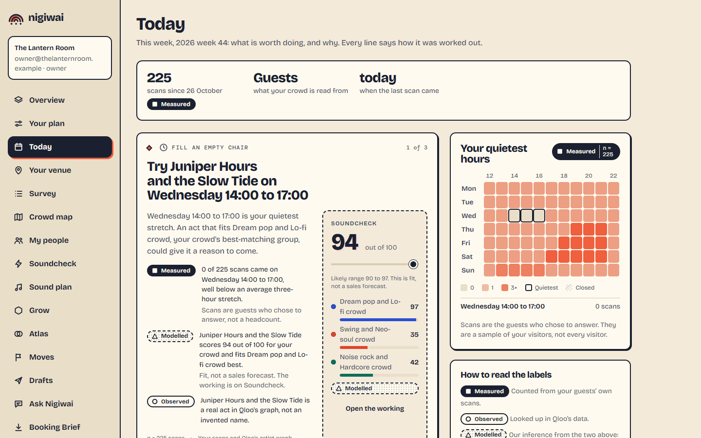](docs/screenshots/owner-today.png) | [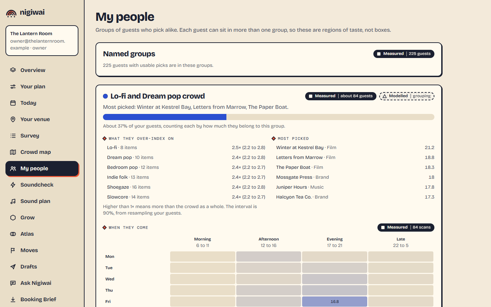](docs/screenshots/owner-my-people.png) |
| **Crowd map** | **Booking Brief** |
| [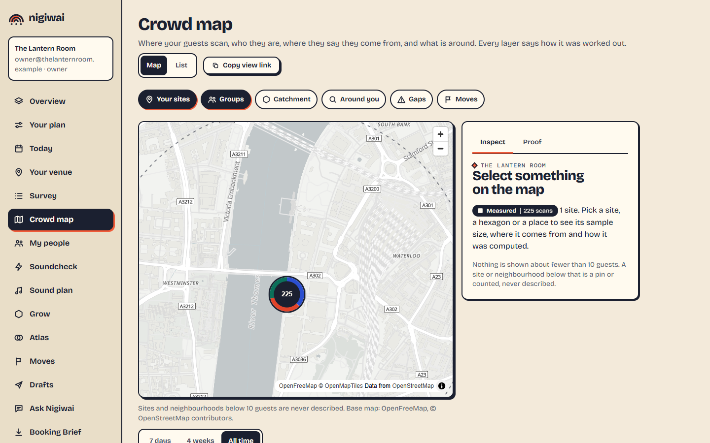](docs/screenshots/owner-crowd-map.png) | [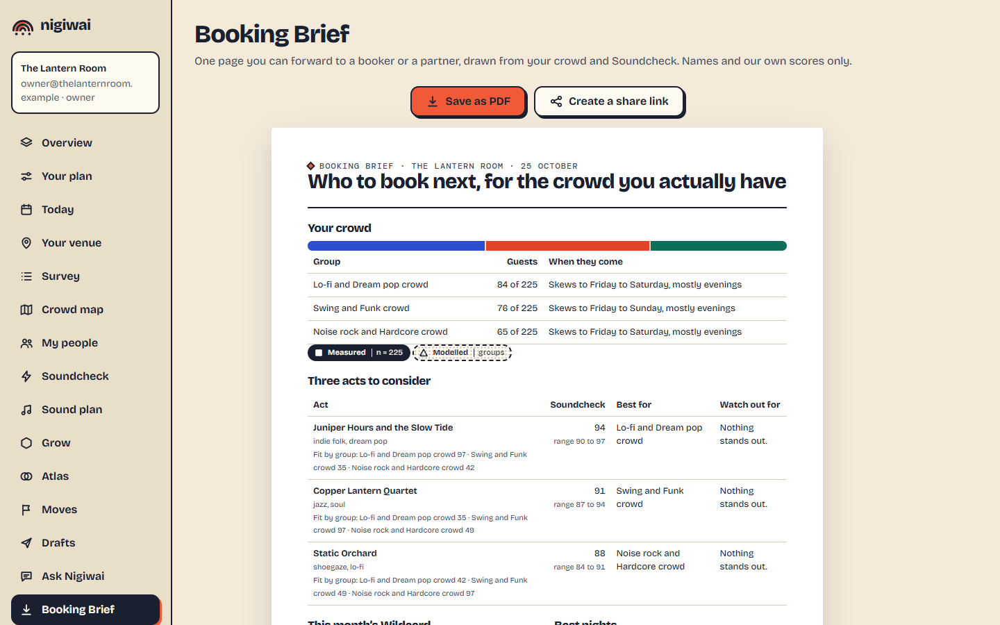](docs/screenshots/owner-booking-brief.png) |
| **Soundcheck** | **Sound plan** |
| [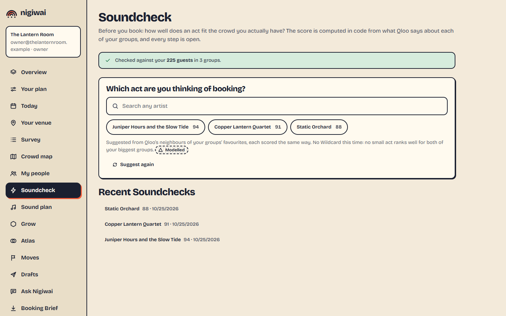](docs/screenshots/owner-soundcheck.png) | [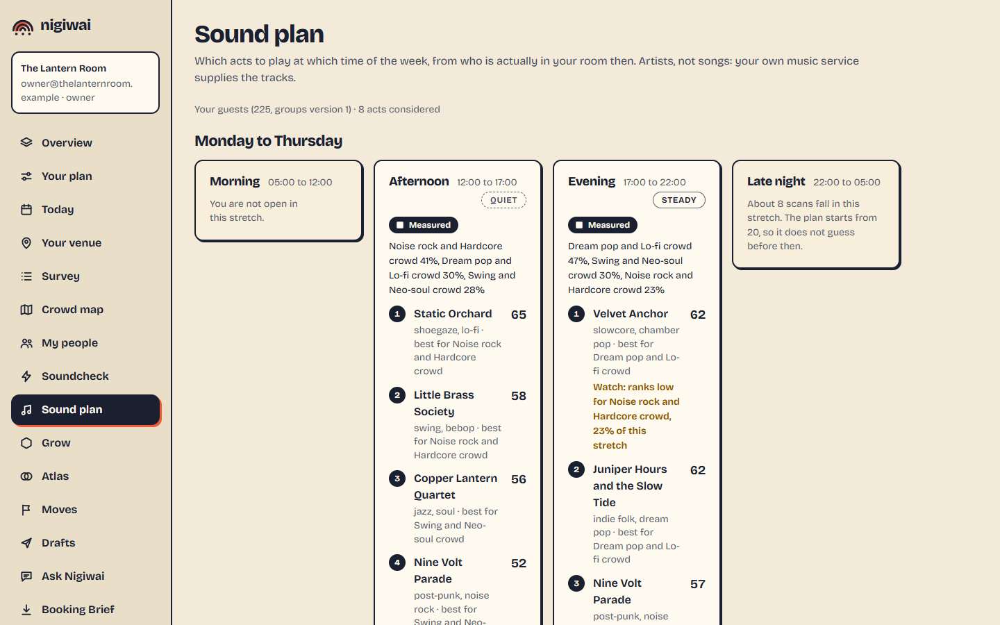](docs/screenshots/owner-sound-plan.png) |

A guest, on a phone: scan, search, pick, and a Taste Card.

<p>
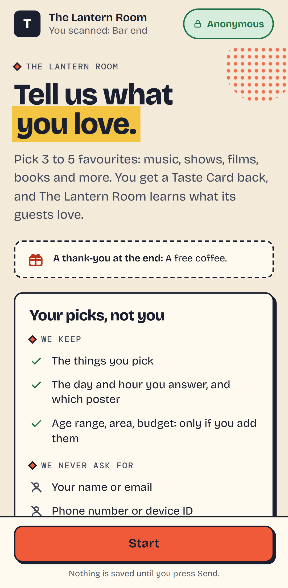 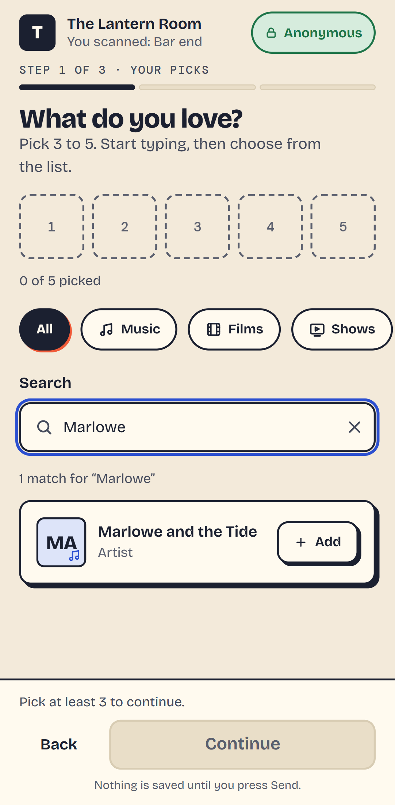 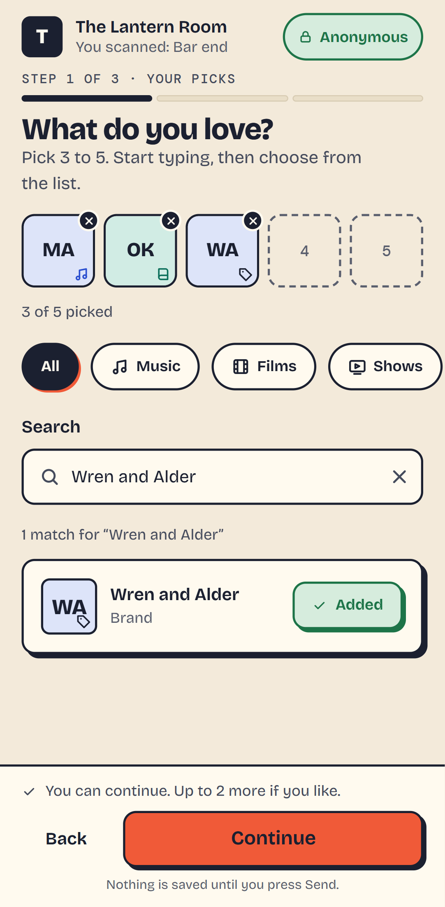 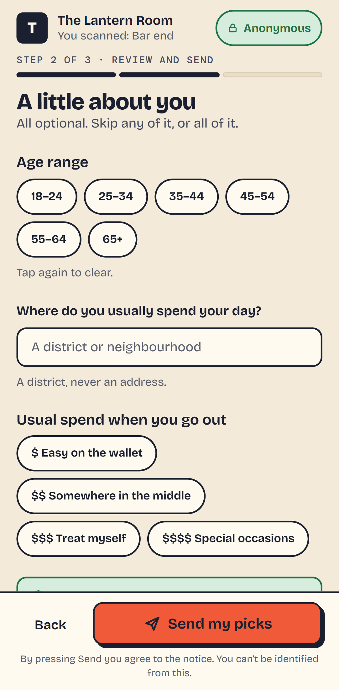 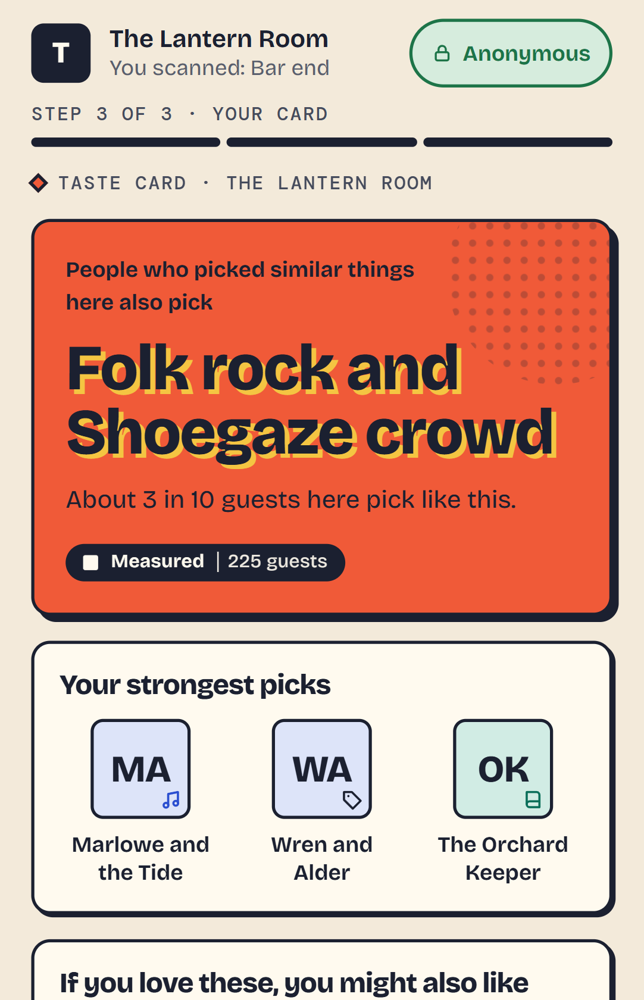
</p>

And the public pages: the front door, Try a venue (with the search for any venue), the evidence including where Qloo lost, the privacy page and the business case. [All screenshots](docs/screenshots).

## Run it locally

You need Docker, [uv](https://docs.astral.sh/uv/), Node 22.19 or newer with pnpm, and [just](https://github.com/casey/just).

```sh
just setup          # Python and web dependencies
just up             # Postgres (PostGIS) and Redis in Docker
just migrate        # create the schema
just dev-api        # API on http://127.0.0.1:8000 (the background worker runs inside it)
just dev-web        # web app on http://localhost:3000   (second terminal)
```

`pnpm install` ends with a warning that some dependencies' build scripts were ignored; nothing here needs them.

Open http://localhost:3000, create an account, set up the venue, publish the survey and create a QR code. Open the survey link it shows, or scan the QR code from the poster.

**The demo venues.** The front page and `/try` list the demo venues once they are built: `just demo` (needs a Qloo key and the network; MusicBrainz is asked politely, one request a second). Until then they say the venues are being prepared. A weekly job rebuilds them; a rebuild that fails leaves the venue showing what it showed.

**Qloo search.** Without a key the picker serves only items it already knows. To enable live search, save your key as `QLOO_API_KEY=...` in a file kept outside the repository and start the API with `NIGIWAI_QLOO_KEY_FILE=<that file>`. The key is read on the server only and is never sent to a browser.

## Tests

```sh
just test               # unit tests, no services needed
just test-integration   # API against real Postgres and Redis (needs just up)
just test-live          # spends Qloo quota; needs a key
just e2e                # real Chrome against the running stack
just check              # lint, types, unit and integration tests
```

## Browser tests

`just e2e` drives real Chrome against the running stack (`just up`, `just migrate`, the API on :8000 and the built web app on :3000). Start the API with these in its environment so the tests never send a question to a service we do not run:

```sh
NIGIWAI_QLOO_KEY_FILE=<your key file>        # Qloo stays real
NIGIWAI_NOMINATIM_URL=http://127.0.0.1:18089 # the map and onboarding specs serve a stand-in place finder here
NIGIWAI_LLM_BASE_URL=http://127.0.0.1:18090  # the Ask and onboarding specs serve a stand-in model here
ANTHROPIC_API_KEY=sk-any-stand-in-value      # read by the API only to talk to that stand-in
NIGIWAI_MIN_COMPLETION_SECONDS=0
```

`reflow.spec.ts` opens every owner page at 320 pixels wide with real data on it and fails if the page gets a sideways scroll bar (WCAG 1.4.10). The judge-mode spec (`demo.spec.ts`) opens the real demo venues, so build them first with `just demo`. `showcase.spec.ts` makes the README's screenshots from a made-up room and runs only with `NIGIWAI_SHOWCASE=1`, so a normal run never rewrites the images; `just samples` saves the sample briefs. The `live.spec.ts` specs spend Qloo quota and run only with `NIGIWAI_E2E_LIVE=1` in the environment of the test command (its two model-led specs also need `NIGIWAI_E2E_LIVE_MODEL=1` and a real model configured on the API, because the stand-in model above would fail them) (the Python live tests, `just test-live`, use `NIGIWAI_RUN_LIVE=1`).

## The language model

Three features use a model: the onboarding interview (the owner describes the business in their own words), Ask Nigiwai, and the "AI alone" panel beside a Soundcheck. Everything else works without one, and where a model would speak the page says when none is connected. Choose a service in the API's environment:

- **Anthropic:** `NIGIWAI_ANTHROPIC_KEY_FILE=<a file holding ANTHROPIC_API_KEY=...>`, and `NIGIWAI_ANTHROPIC_WORKSPACE_ID` if the key is not scoped to one workspace (the service then refuses every request and says so).
- **Any OpenAI-compatible service:** `NIGIWAI_LLM_PROVIDER=openai`, `NIGIWAI_LLM_BASE_URL`, `NIGIWAI_LLM_MODEL` and the key in `NIGIWAI_LLM_API_KEY` (or a file named by `NIGIWAI_LLM_KEY_FILE`). `NIGIWAI_LLM_EXTRA_BODY` is JSON merged into every request.

The product's own checks do not depend on the model: an item must have been returned by a Qloo call, a recorded answer needs a quote the owner wrote, and a failing or busy model hands over to the plain list or the fixed form. `just test-live` runs the model-led features against whichever service is configured (set `NIGIWAI_RUN_LIVE=1`, a model, and a Qloo key); `docs/DECISIONS.md` D27 records what the first real runs showed.

## Deploy

`docker-compose.prod.yml` runs Postgres, Redis, a one-shot migration, the API and the web app. Copy `.env.prod.example` to `.env.prod`, fill it in and run `docker compose --env-file .env.prod -f docker-compose.prod.yml up -d --build`. Put a TLS-terminating reverse proxy in front of the web port that **overwrites** `X-Forwarded-For`; the API trusts that header for rate limiting. `NIGIWAI_PUBLIC_BASE_URL` must be the public address: poster QR codes, booking-brief links and team invitation links are built from it. The web app sends a Content-Security-Policy and a Strict-Transport-Security header; the proxy should pass them through. Migrations run as the table-owner role and the API as a separate non-owner role, and the API refuses to start if it is connected as a role that would bypass row-level security. Build the demo venues once with `docker compose --env-file .env.prod -f docker-compose.prod.yml run --rm worker python -m nigiwai_api.demo`; the worker service then refreshes them weekly.

## Layout

| Path | What |
|---|---|
| `packages/qloo-guard` | The only code that talks to Qloo |
| `packages/tribes` | The group model: tags, soft factors, stability tests, naming, rhythm, scenes from lineups |
| `packages/fit` | The Fit Verdict: a reproducible 0 to 100 score from visible components |
| `apps/api` | FastAPI service: accounts, tenancy, picker, survey, posters, groups, card, lineups, Soundcheck, brief, map, background jobs |
| `apps/web` | Next.js app: guest survey and owner screens |
| `db` | Alembic migrations (plain SQL) |
| `docs` | Decisions, build state, QA matrix, open questions, the submission write-up, sample briefs and screenshots |
| `evals` | Measurements behind decisions (group stability against the research, what favourite places do to the groups) |
| `tools` | Poster fonts, the design sync, and the sample-brief maker |

## Licence

MIT. Third-party fonts and data are credited in [NOTICE.md](NOTICE.md). Qloo's own terms govern use of its API and data.
